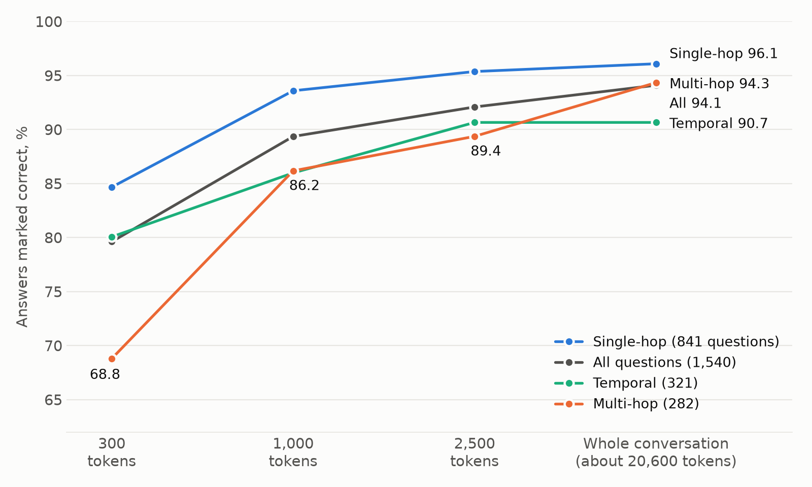
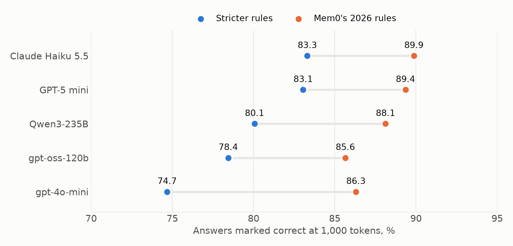


Cogi, the memory I built for Claude Code, finds the right past session for 99.0% of the questions on LongMemEval. That number is true, and it is the least useful one I measured. On another test the same memory scores 74.7% or 89.9%, depending on who answers and who grades. The result I trust most is smaller and less flattering: 1,000 tokens lose about 4.7 points to rereading the whole conversation, and almost all of that loss sits in the questions where retrieval missed something.


## TL;DR

**What you will learn:**

- What a local memory with no LLM at write time scores on LongMemEval-S and LoCoMo, with paired confidence intervals
- Why my first headline, "level with the whole conversation", held only for an old answering model
- Why changing the grader moved the same answers by 11.6 points, more than twice the gap between memory and full context
- Which evaluation habits I would keep, and what these benchmarks cannot say about a coding agent

## The bet behind Cogi

Claude Code forgets. A long session gets compacted, a new session starts empty, and the idea from last week that nobody wrote down is gone. <!-- TODO Krzysztof: one or two sentences of your own: the moment that made you build this. My notes only have the requirement ("getting back an idea from a week ago that nobody wrote down") and one session compacted from 782k to 13k tokens. -->

Most memory products answer this by having an LLM extract facts from each message. Cogi makes the opposite bet: keep every message word for word with its date, make no AI calls to store anything, and spend the effort on finding the right text later. Search fuses BM25 keywords with [EmbeddingGemma 2](https://github.com/meridian21lab/cogito-mem/blob/main/docs/benchmarks.md#setup) in llama.cpp, and a query returns stored text inside a token budget. Everything sits in one SQLite file on my laptop, and Claude Code reaches it through hooks and two MCP tools.

Nothing here is trained. The idea grew out of my [MrCogito memory research](/posts/memory-that-reads-by-content/), but the requirements say to train only if an off-the-shelf reranker first gains 5 points or more, and that gate has not been run.

Cogi is about two weeks old. Claude Code sessions wrote the harnesses and ran the evaluations; I decided what to test and what to believe. All runs come from a MacBook Pro with an M5 Max, on 19 and 20 October 2026. The [benchmarks page](https://github.com/meridian21lab/cogito-mem/blob/main/docs/benchmarks.md) has the setup and commands, and a [comparison note](https://github.com/meridian21lab/cogito-mem/blob/main/docs/notes/locomo_comparison_20261019.html) has the current-model runs.

## 99.0%: finding the right session

[LongMemEval](https://arxiv.org/abs/2410.10813) gives each of its 500 questions a history of about 50 chat sessions, roughly 115k tokens, and labels the sessions that hold the answer. The number local memory tools publish is session recall at 5 (R@5): is at least one answer session in the first five results? No LLM is involved, so no grader can distort it.

Cogi misses 5 questions of 500, which gives 99.0% (95% CI 97.7 to 99.6). The published runs I could check on 20 October sit just below: [hippo-memory](https://github.com/kitfunso/hippo-memory/blob/main/docs/evals/2026-09-23-longmemeval-reproduction.md) at 98.0, [deja-vu](https://github.com/vshulcz/deja-vu) at 97.2, [MemPalace](https://github.com/MemPalace/mempalace/blob/develop/benchmarks/BENCHMARKS.md) in raw mode at 96.6, and [agentmemory](https://github.com/rohitg00/agentmemory/blob/main/benchmark/LONGMEMEVAL.md) at 95.2. With 500 questions the first three are level. These are their own runs and a dated snapshot, and these projects keep moving.

Three things made me stop quoting that number on its own.

**The test is close to saturated.** My keyword-only run, with no embeddings at all, already reaches 95.0. Five results out of about fifty is a tenth of the haystack, and one answer session is enough to count as a hit. Ask for more and the picture changes:

| Same run, all 500 questions | Score |
|---|---|
| Any answer session in the top 5 (R@5) | 99.0% |
| Every answer session in the top 5 (all@5) | 90.8% |
| An answer-holding message in the top 5 messages (479 questions) | 85.0% |

On the stricter metric I am not ahead of anyone: [gbrain](https://github.com/garrytan/gbrain-evals/blob/main/docs/benchmarks/2026-05-07-longmemeval-s.md) reports all@5 of 93.19 with OpenAI's embeddings and 95.53 with a Voyage reranker over the 470 answerable questions, against Cogi's 91.3 on the same set.

**The published protocol can read the future.** Everyone's number, mine included, lets search return sessions dated after the question. Real memory cannot do that, and Cogi's default does not. Asked as of each question's date, R@5 falls from 99.0 to 95.0, because 44 questions have an answer session from later the same day. That is a labelling quirk more than a retrieval failure, but the comparable number and the realistic one differ by four points.

**Embeddings earn their place mostly on one kind of question.** On preference questions ("what would I like…"), where the question's words rarely appear in the answer, hybrid search scores 100 against 73.3 for keywords alone. Across all questions, as of the question date, the gain over keywords is 4.0 points (95% CI 2.2 to 5.8).

## "Level with the whole conversation", and why I no longer say it

Finding a session is not the job. The job is giving Claude few enough tokens that it can still answer. [LoCoMo](https://arxiv.org/abs/2402.17753) tests this with 10 long conversations and 1,540 questions, and the [Mem0 paper](https://arxiv.org/abs/2504.19413) set the common protocol: gpt-4o-mini answers from what the memory returns, and gpt-4o-mini grades.

The control I care about is the whole conversation, about 20,600 tokens, answered and graded the same way. On the first five conversations (762 questions, because it was the expensive arm), whole conversation scored 76.5 and Cogi at 1,000 tokens scored 74.7. The paired difference is −1.8 points, 95% CI −5.5 to +1.8. So I wrote "level with rereading the whole conversation" on the [results page](https://meridian21lab.github.io/cogito-mem/results.html).

Then I ran the same comparison with current models, on all 1,540 questions, under Mem0's [2026 protocol](https://github.com/mem0ai/memory-benchmarks), with GPT-5 mini grading. The eight runs cost about $19.

| Answering model | Whole conversation | Cogi, 1,000 tokens | Paired gap (95% CI) |
|---|---|---|---|
| Claude Haiku 5.5 | 94.5 | 89.9 | −4.6 (−6.0 to −3.3) |
| GPT-5 mini | 94.1 | 89.4 | −4.7 (−6.2 to −3.3) |
| Qwen3-235B | 92.5 | 88.1 | −4.4 (−6.0 to −2.8) |
| gpt-oss-120b | 89.0 | 85.6 | −3.4 (−5.1 to −1.7) |
| *gpt-4o-mini (paper protocol, 762 questions)* | *76.5* | *74.7* | *−1.8 (−5.5 to +1.8)* |

Every interval on the current models excludes zero. The fair sentence is that 1,000 tokens, about 5% of the conversation, reach about 95% of the whole-conversation score while cutting the prompt from 27,602 to 2,966 tokens on GPT-5 mini. That is still a good trade. It is not "level".

The old tie was partly luck. Split by category, the gpt-4o-mini comparison hides two large gaps that cancel: Cogi wins temporal questions by 15.4 points (7.1 to 24.4) and loses multi-hop by 12.7 (2.8 to 22.5). My guess is that the weak model gets lost working out dates in 20,000 tokens. With stronger models the temporal advantage goes away, and the multi-hop loss stays at 8 to 11 points on all four.

<!-- TODO Krzysztof: the README and results page still lead with "level with" and "98%". Decide before publishing: update them first (my recommendation), then this sentence becomes "I have changed the results page". -->

### The gap is a retrieval problem

Take GPT-5 mini. On the 1,114 questions where every labelled evidence turn was inside the 1,000 tokens, Cogi matches the whole conversation: 95.7 against 95.1. On the other 426 it falls to 72.8 against 91.5. When the right text arrives, a short context reads as well as a long one. These two groups are not random samples, so read this as a diagnosis, not a causal estimate.

Multi-hop questions explain the shape, because all of their evidence fits in the budget only 26.6% of the time, against 88.1% for single-hop. The budget curve shows it:



At 2,500 tokens the overall gap shrinks to −2.0 (−3.3 to −0.8), and temporal questions are level at 0.0. At 300 tokens it grows to −14.5 (−16.6 to −12.5), and multi-hop to −25.5.

That 300 matters. Cogi's hook adds at most 300 tokens to each prompt, and Claude gets 1,000 by default only when it calls `memory_query` itself. So the automatic path sits closer to 79.6 than to 89.4, and I have not measured it as a whole, with its filters for weak matches and the current session.

## The grader moves more than the memory

I re-graded the same 1,540 gpt-4o-mini answers under Mem0's 2026 rules. Not one answer changed. The score went from 74.7 to 86.3: 180 answers flipped to correct and one flipped to wrong. That is 11.6 points from the rubric alone, more than twice the gap I just spent a section on.

Under the [2026 prompt](https://github.com/mem0ai/memory-benchmarks), one correct item from a list is enough, dates within 14 days count, and durations within 50% count. Those rules turn "2 May" and "15 May" into the same answer.



The dataset has its own limits. An [independent audit of LoCoMo](https://github.com/dial481/locomo-audit) found 99 of the 1,540 gold answers wrong, which caps a truly correct system at 93.57%, and found the judge accepting 62.81% of vague but on-topic wrong answers. GPT-5 mini with the whole conversation scores 94.1 under the 2026 rules, above that ceiling.

This limits what I can say about other systems. The results page shows each memory as a share of its own harness's whole-conversation score: Cogi 98% with gpt-4o-mini, against 94% for Mem0 with graph, 92% for Mem0 and 91% for Zep in the Mem0 paper. Those are April 2025 versions, and I ran no competitor myself. [Zep disputes Mem0's run](https://www.getzep.com/blog/lies-damn-lies-statistics-is-mem0-really-sota-in-agent-memory/) and reports 75.14, which would be 103%. My own whole-conversation run scored 76.5 where the paper reports 72.9, under what should be the same setup, and I cannot explain the 3.6 points.

My opinion: a LoCoMo score without its answering model, its grading rules and a whole-conversation baseline from the same harness tells you very little.

## The ablation worth stealing

My first default, hybrid search with each message embedded on its own, scored 32.9% at 300 tokens on the first three LoCoMo conversations. Plain BM25 scored 47.3%. Adding embeddings made it 14 points worse. My reading is that a short chat turn means little on its own.

Embedding each message together with the message it replies to brought hybrid to 40.0%. Also adding the author's name ("Caroline: …") reached 50.9%, the default today. This ran on 383 questions with a stand-in embedding model, so treat the sizes as rough. With the shipped model on all 10 conversations, hybrid beats keywords by 7.0 points at 300 tokens (5.3 to 8.8).

The choice had a price: I tuned on LoCoMo, so LoCoMo is no longer a held-out test for Cogi.

## What none of this proves

- **Its intended size is untested.** A LoCoMo conversation is about 20k tokens and a LongMemEval-S history about 115k, while the design target is up to 10 million. LongMemEval-M, at about 1.5M tokens per question of one person's similar sessions, was the gate in my own requirements, and it has not been run.
- **Speed is flattered.** The p95 search over 10M tokens is 26 ms on the M5 Max CPU, against a 100 ms target, but that store used synthetic text and random stored vectors. An earlier version on a 4-core cloud VM took 163 ms. My real memory is only 510,018 tokens so far; the searches behind this post took 11 to 29 ms.
- **Neither benchmark is a coding session.** When I first captured Cogi's own development sessions, recall often missed decisions, because they lived in files and tool output that capture skips. Version 0.2.0 added a short note of each turn's commands and files. I have not measured whether it helps.
- **Nothing ran head to head, and each score is one run** on my machine. <!-- TODO Krzysztof: results/ is untracked in the repo. Publish the per-question files so the CIs in this post can be checked? -->

While drafting this post, Claude searched my memory through Cogi. Asked how far to trust these numbers, it brought back a blunt assessment from 19 October that supplied several caveats above. Asked why I started the project, it returned MrCogito notebook discussions that did not answer the question. One hit and one miss is an anecdote, and turning it into a measurement is the next evaluation's job.

## What I would do differently

If you are evaluating a memory for your own agents, these habits changed my conclusions:

- **Run the whole-context baseline in the same harness.** It is the only control that survives a change of model, prompt or grader.
- **Compare paired, per question, with intervals, and split by category.** The average hid two gaps that cancelled.
- **Repeat with a current answering model.** Mine turned a tie into a measurable loss, for about $19.
- **Re-grade once under different rules** to see how much of your result the grader owns.
- **Measure the path users get.** My headline was 1,000 tokens, and my hook sends 300.
- **Fix your settings before the test that decides.** I did this late, and one of my two benchmarks paid for it.

For Cogi, next comes LongMemEval-M, then a test set from my own Claude Code sessions, then Mem0's open-source version and a plain RAG baseline through the same harness.

My opinion so far: good retrieval over raw messages is a strong baseline that costs no model calls on write. That is a finding about raw-text retrieval, not about anything special in Cogi. On questions that need many facts at once it falls short, and that is where a smarter writer might earn its bills. Whether any of this holds at a million tokens, no number here can tell me.

Cogi is [open source](https://github.com/meridian21lab/cogito-mem) under MIT and early. If you try it, I would most like to hear what it failed to bring back:

```sh
claude plugin install cogito-mem --marketplace meridian21lab/cogito-mem
```

## References

1. Wu, D. et al. (Oct 2024). [**LongMemEval: Benchmarking Chat Assistants on Long-Term Interactive Memory**](https://arxiv.org/abs/2410.10813). arXiv:2410.10813
2. Maharana, A. et al. (Feb 2024). [**Evaluating Very Long-Term Conversational Memory of LLM Agents**](https://arxiv.org/abs/2402.17753). arXiv:2402.17753
3. Chhikara, P. et al. (Apr 2025). [**Mem0: Building Production-Ready AI Agents with Scalable Long-Term Memory**](https://arxiv.org/abs/2504.19413). Mem0. arXiv:2504.19413
4. Chalef, D. and Rasmussen, P. (May 2025). [**Lies, Damn Lies, & Statistics: Is Mem0 Really SOTA in Agent Memory?**](https://www.getzep.com/blog/lies-damn-lies-statistics-is-mem0-really-sota-in-agent-memory/). Zep.
5. dial481. [**locomo-audit**](https://github.com/dial481/locomo-audit). GitHub.
6. Mem0. [**memory-benchmarks**](https://github.com/mem0ai/memory-benchmarks). GitHub.

*All Cogi numbers are my own runs and have not been independently reproduced. Other projects' scores are self-reported, checked against their documents on 19 and 20 October 2026.*
